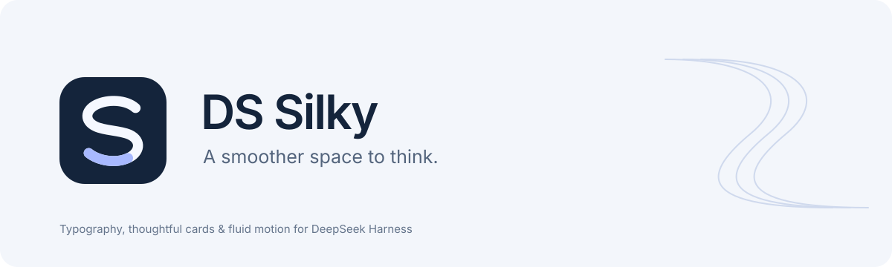

<p align="center">
  
</p>

<p align="center">
  让 DeepSeek Harness 的文字、卡片和输出节奏，融为一体。
</p>

<p align="center">
  <a href="https://www.npmjs.com/package/@kafukatree/ds-silky">npm</a> ·
  <a href="#安装">安装</a> ·
  <a href="#体验">体验</a> ·
  <a href="CHANGELOG.md">更新记录</a> ·
  <a href="DEVELOPMENT.md">开发说明</a>
</p>

---

**DS Silky** 是 DeepSeek Harness 的界面增强插件。它将会话排版、工具卡片、提问与文件交付，以及流式文字的呈现节奏整理成一套连贯的体验。

不改变模型、不修改回答内容，也不需要替换应用。插件以一个预构建客户端脚本加载，没有新增运行时依赖或外部字体请求。

## 体验

| 细节 | 改善 |
| :--- | :--- |
| **读起来协调** | 正文与界面各有清楚的字体层级；标题、说明、按钮和输入不再各自抢眼。 |
| **输出更连贯** | 根据上游到达节奏调节文字呈现，段落按阅读顺序展开，行内代码跟随正文淡入。 |
| **卡片更克制** | 紧凑的文件交付卡、层级清楚的提问卡，以及连接为同一底板的 PTC 代码与输出。 |
| **工具更一致** | 普通终端输出使用中性色，保留程序自身 ANSI 颜色；结构化载荷独立高亮。 |
| **长会话更轻** | 对已结束的远处历史行使用离屏裁剪；选中文字时恢复，尊重减少动态效果设置。 |

### 卡片预览

<p align="center">
  
</p>

<sub>基于宿主 DOM 与样式的独立预览，不是真实桌面截图。实际字体取决于系统与 DSH 字体设置。</sub>

## 安装

在 DeepSeek Harness 的插件管理界面搜索 **`@kafukatree/ds-silky`** 并安装。支持命令行的环境，也可以安装到已有的桌面 profile：

```bash
dsh plugin --profile desktop add @kafukatree/ds-silky
```

安装后按 **⌘R** 重载 macOS 窗口；若仍使用旧版，完全退出应用再启动。其他系统使用应用提供的重载方式。若你使用自定义 profile，将命令中的 `desktop` 换成对应名称。

也可以从 [GitHub Releases](https://github.com/KafukaTree/ds-silky/releases) 下载 `.tgz` 发布包，再安装本地文件：

```bash
dsh plugin --profile desktop add ./kafukatree-ds-silky-0.20.0.tgz
```

### 从旧版迁移

DS Silky 原名 `dsh-anthropic-fonts`。安装新版前，在插件管理中停用旧版，避免两份插件同时启用。如果旧版是通过 CLI 安装到同一 profile，可移除旧包：

```bash
dsh plugin --profile desktop remove dsh-anthropic-fonts
```

若旧版是手工加入本地配置的，请停用那条旧配置；不需要删除自己的源码备份。新版保留旧的内部样式与清理标识，帮助热替换时释放已有状态。

### 卸载

```bash
dsh plugin --profile desktop remove @kafukatree/ds-silky
```

随后重载窗口，恢复宿主样式。

## 兼容性

- 宿主声明要求 **DeepSeek Harness ≥ 0.2.2-rc.1**；当前适配依据为 **0.2.2-rc.2** 的源码与已观察结构。
- 插件引用宿主的部分编译类名。宿主升级后可能需要更新适配，版本范围不代表已验证未来版本。
- 字体遵循 DSH 设置及系统回退。仓库不分发字体文件；未安装的字体会回退到可用字体。
- 独立 Chromium 回归覆盖流式、展开收起、热替换与资源清理；真实 React 高亮桥、整应用交互和长期性能仍需实际环境验证。

## 开发

需要 **Node.js 22+**；浏览器回归还需要本机 **Google Chrome**。构建与测试使用 Node 内置模块，无需安装构建依赖。

```bash
npm run build
```

```bash
npm run verify
```

维护 `src/`，不要直接修改生成文件 `lib/client.js`。构建检查宿主适配引用、版本、语法、CSS 基线与产物体积；测试检查生成文件与源码是否一致。

源码按职责拆分，发布时仍组装为一个闭包；共享状态与清理顺序见 [开发说明](DEVELOPMENT.md)。

## 反馈

在 [Issues](https://github.com/KafukaTree/ds-silky/issues) 中提供 DSH 版本、操作系统、复现步骤和截图即可。涉及流式问题时，短录屏通常比静态截图更有帮助；请先移除会话中的私人内容。

---

MIT License · 一个面向 DeepSeek Harness 的社区插件，非官方产品。
